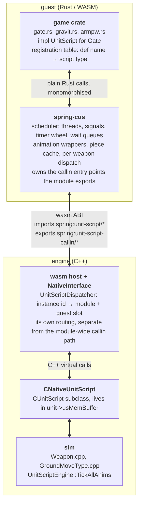

# CUS — Core-Wasm Unit Scripts

**Status:** proposal, nothing implemented
**Scope:** unit scripts written in Rust/WASM alongside the existing COB and Lua (LUS) options, at functional parity with `cont/base/springcontent/LuaGadgets/Gadgets/unit_script.lua`
**Naming:** LUS = Lua Unit Script, CUS = Core-wasm Unit Script

Engine paths are in the `spring-bar` checkout at `47def3ba27`; line numbers are indicative.

---

## 1. Target and shape

### 1.1 Who this is for

The design target is a game the size of Beyond All Reason, Zero-K or MCL, not a jam game. Concretely, BAR ships:

| | count | lines |
|---|---|---|
| `.bos` unit scripts (COB source) | 849 | 226,357 |
| `.cob` (compiled) | 851 | — |
| `.lua` unit scripts (LUS) | 31 | 5,913 |

So the incumbent at scale is COB by a factor of ~27, and a single unit's script runs to four figures — `scripts/Units/armpw.bos` is 1,639 lines, most of it machine-generated from Blender by Skeletor_S3O. Two consequences for CUS: the scale that matters is tens of thousands of live units with scripts attached, and the authoring surface has to be a good *codegen target*, not only pleasant to hand-write.

The Cabal games are the first port targets because they are small and already Rust — Gravitas has 16 scripts totalling 5,116 lines — but nothing in the design is sized for them.

### 1.2 Layers



| Module | Lives in | Owns |
|---|---|---|
| `CNativeUnitScript` | `rts/Sim/Units/Scripts/NativeUnitScript.{h,cpp}` | the 40 sim-facing virtuals, callin presence mask, death settlement, creg |
| unit-script dispatch | `rts/NativeInterface/api/`, `rts/wasm/`, codegen | typed per-instance callin transport, the `spring:unit-script` callout module |
| `spring-cus` | `spring-bar/rust/crates/spring-cus`, a crate from the start | the scheduler and every LUS semantic |
| game scripts | each game's `wasm-src/rules-synced/` | `UnitScript` impls, registration table |

`spring-cus` is a sibling crate to the existing guest SDK. Games already depend on `spring` by path:

```toml
spring     = { path = ".../spring-bar/rust/crates/spring", features = ["alloc"] }
spring-cus = { path = ".../spring-bar/rust/crates/spring-cus" }
```

so it costs nothing to set up and it keeps the scheduler versioned with the ABI it talks to, which is where the coupling actually is.

---

## 2. How unit scripts work today

Worth reading even if you know Spring; the CUS design is mostly a response to specifics in here.

### 2.1 COB

COB is a stack bytecode VM built into the engine (`rts/Sim/Units/Scripts/Cob*`). Games write `.bos` source and compile it to `.cob` with an external compiler. The source looks like this — `armllt.bos`, a BAR laser tower:

```c
piece base, turret, sleeve, flare;

AimWeapon1(heading, pitch)
{
	signal SIGNAL_AIM1;
	set-signal-mask SIGNAL_AIM1;
	turn turret to y-axis heading speed <300.071429>;
	turn sleeve to x-axis <0.0> - pitch speed <200.043956>;
	wait-for-turn turret around y-axis;
	wait-for-turn sleeve around x-axis;
	start-script RestoreAfterDelay();
	return (1);
}
FireWeapon1()
{
	emit-sfx 1024 + 0 from flare;
}
QueryWeapon1(pieceIndex)
{
	pieceIndex = flare;
}
```

Animation, sleeping, waiting, signals and threads are all *language keywords*, compiled to opcodes (`MOVE`, `TURN`, `WAIT_TURN`, `SLEEP`, `SIGNAL`, `START`… in `CobOpCodes.h`). Arithmetic is integer only: a full rotation is `COBSCALE` = 65536, and `<300.071429>` is fixed point sugar the compiler converts.

**Why it is fast.** A COB thread is a plain struct — `pc`, a data stack, a call stack, `wakeTime`, `signalMask`, `waitPiece`, `waitAxis`, `state` (`CobThread.h:150-175`). Starting a thread appends to a vector; sleeping pushes onto a binary heap ordered by wake time and tie-broken by thread id for determinism (`CobEngine.h:36-41`); waking pops it. No allocation per event, no hashing on the hot path, and the whole interpreter is C++ working on ints.

**Why it is still used.** Partly speed, partly that 226k lines of `.bos` and the Blender-to-BOS toolchain exist and work.

### 2.2 LUS

LUS is a Lua gadget, `unit_script.lua`, 842 lines, plus a thin engine class `CLuaUnitScript`. The engine calls into Lua per callin; everything thread-shaped is implemented in Lua on top of coroutines. From Gravitas' `gate.lua`:

```lua
local gate = piece('Gate')
local signalMask = 1

function script.Activate()
    Spring.UnitScript.Signal(signalMask)
    StartThread(function()
        Spring.UnitScript.SetSignalMask(signalMask)
        GG.AdjustWallTerrain(unitID, 0)
        Sleep(500)
        Spring.PlaySoundFile("sounds/gate.ogg", 0.7)
        Move(gate, z_axis, -168, 180)
        WaitForMove(gate, z_axis)
        Spring.SetUnitBlocking(unitID, false, false, false, false, false, false, false)
    end)
    return 1
end
```

Far nicer to write than BOS, and it gets full access to the Lua API, which BOS does not have.

**What it costs, per operation** (`unit_script.lua:384-405`, `240-262`):

| Operation | Work |
|---|---|
| `StartThread` | `coroutine.create` — a fresh Lua coroutine with its own stack — plus a thread table, plus insertion into a per-unit table keyed by the coroutine object |
| every wake | `coroutine.resume`, error-checked, with a `debug.traceback` path on failure |
| every callin | `GetActiveUnit()` off an ambient stack, then table lookups to reach the script function |
| `Sleep` | index into `sleepers[frame]`, allocating that table if this is the first sleeper for the frame |
| `WaitForMove` | `waitingForMove[piece*3+axis]` table, allocated per key, reallocated (`= {}`) on every wake |
| engine side | `lua_checkstack`, push function, push args, `lua_pcall`, pop and convert results, per callin (`LuaUnitScript.cpp:500-565`) |

None of that is unreasonable Lua; it is just a lot of allocation and indirection per event, and it is why a BAR-scale game with thousands of units keeps its walkers in COB.

**Determinism.** The gadget warns at `unit_script.lua:158` that its thread table is keyed by coroutine, so careless iteration desyncs.

### 2.3 The gap CUS fills

COB is fast and serializable but a dead-end language with no engine API. LUS is expressive with full API access but pays coroutine and table costs per event. CUS aims for COB's cost profile with better-than-LUS expressiveness, in a language games already use for their rules and UI modules.

---

## 3. Three structural facts

These decide most of the design, and all three are verified in the engine source.

### 3.1 Scripts attach through a callout at `UnitCreated`

`CUnitScriptFactory::CreateScript` (`UnitScriptFactory.cpp:28`) handles `*.cob` and hands everything else `CNullUnitScript`, deferring — per its own comment — to `LuaUnitScript::CreateScript`. Attachment for a Lua script happens later, from the gadget, when it calls `Spring.UnitScript.CreateScript(unitID, callInTable)` (`LuaUnitScript.cpp:1163`):

```cpp
unit->script = CUnitScriptFactory::CreateLuaScript(unit, L);
```

CUS uses the same route: the rules guest calls a create-script callout during its own `UnitCreated`, and the engine swaps `unit->script`. This gives us three things directly — no new file format or extension sniffing, one factory method beside `CreateLuaScript`, and COB/LUS/CUS coexisting in one game since attachment is per unit.

### 3.2 The scheduler is a guest concern

The engine's threading surface for Lua scripts is two calls wide. `WaitForTurn`/`WaitForMove`/`WaitForScale` return a `needsWait` bool (`LuaUnitScript.cpp:1882+`), and `AnimFinished` (`LuaUnitScript.cpp:933`) dispatches `TurnFinished`/`MoveFinished`/`ScaleFinished`. That is the whole of it. `StartThread`, `Sleep`, `Signal`, `SetSignalMask`, blocking `WaitFor*`, the sleeper queue and the thread registry are all Lua, in the gadget.

So CUS writes its scheduler in Rust, and the engine gets no new scheduler, no coroutine support and no guest suspension. A guest runs each callin to completion — a wasm guest cannot yield mid-call — and the scheduler drives progress by being re-entered on the next event or frame. That is enough, because it is exactly how the Lua gadget behaves once you strip the coroutines: a thread that sleeps is a table in `sleepers[frame]` until `GameFrame` resumes it.

### 3.3 Animation stepping is engine-side, and the multithreading does not reach scripts

`CUnitScriptEngine::Tick` (`UnitScriptEngine.cpp:126-163`) runs two passes over the `animating` vector:

```cpp
for_mt(0, animating.size(), [&](const int i) {   // MT pass
    animating[i]->TickAllAnims(deltaTime);
});
// ... then a single-threaded pass
for (size_t i = 0; i < animating.size(); ) {
    currentScript = animating[i];
    if (!currentScript->TickAnimFinished()) { ... }
}
```

The MT pass is pure C++ interpolation of piece positions and rotations (`UnitScript.cpp:199-240`) — it touches `LocalModelPiece` floats and never enters Lua. Everything that calls *into* a script runs in the second pass, which `UnitScript.cpp:282-284` documents as deliberately single-threaded so `AnimFinished` ordering stays consistent across the simulation.

So the accurate claim is: **script code never runs multithreaded, in Lua or in wasm, and CUS does not change that.** What CUS inherits for free is that per-frame per-piece animation stepping never crosses into the guest at all — a unit with a five-second `Turn` in flight costs the guest nothing for those 150 frames, and gets one `TurnFinished` at the end. `animating` holds only scripts with live animations (`AddInstance`/`RemoveInstance`), so idle units are not visited either.

### 3.4 What the dispatch rate actually is

Per-callin, per unit that implements it:

| Callin | Rate |
|---|---|
| `ChangeHeading` | up to once per frame while turning, gated by `minScriptChangeHeading` — the highest-frequency callin |
| `AimWeapon` | once per `reaimTime` = `GAME_SPEED>>1` = 15 frames per weapon, so ~2/s (`Weapon.cpp:380,423`) |
| `QueryWeapon`, `AimFromWeapon` | on weapon-piece updates (`Weapon.cpp:241,244`) |
| `MoveFinished`, `TurnFinished`, `ScaleFinished` | once per animation completion |
| `Create`, `Killed`, `Activate`, `StartMoving`, `FireWeapon`, `Shot`, `HitByWeapon`, `Destroy`, … | once per occurrence of the event |

Plus exactly one guest call per sim frame for the whole module, to drain due tasks (§5.5). Everything else is event-driven, so a unit standing still with no animation running generates zero guest calls per frame.

---

## 4. Engine implementation

### 4.1 `CNativeUnitScript`

Named for the NativeInterface layer rather than for wasm: native shared-library modules and Core-WASM guests both reach the engine through NativeInterface, so one class serves both and the wasm host becomes one dispatch backend behind it.

It implements the ~45 pure virtuals in `UnitScript.h:171-220`, modelled on `CLuaUnitScript`, forwarding each to the owning guest. The 40 callin slots come from `LuaScriptNames.h`:

```
Destroy StartMoving StopMoving StartSkidding StopSkidding ChangeHeading Activate
Killed Deactivate WindChanged ExtractionRateChanged RockUnit MoveRate setSFXoccupy
HitByWeapon QueryLandingPads Falling Landed BeginTransport QueryTransport
TransportPickup StartUnload EndTransport TransportDrop StartBuilding StopBuilding
QueryNanoPiece QueryBuildInfo MoveFinished TurnFinished ScaleFinished QueryWeapon
AimWeapon AimShield AimFromWeapon FireWeapon EndBurst Shot BlockShot TargetWeight
```

```cpp
class CNativeUnitScript : public CUnitScript {
public:
    CNativeUnitScript(CUnit* unit, NativeScriptModuleRef module, uint32_t instance, uint64_t provided);

    void Killed() override;
    int  QueryWeapon(int weaponNum) override;                  // synchronous result
    void AimWeapon(int weaponNum, float h, float p) override;  // void, see 4.4
    void QueryLandingPads(std::vector<int>& out) override;     // list result
    // ... 40 slots

private:
    bool Provides(int slot) const { return (providedMask >> slot) & 1ull; }

    NativeScriptModuleRef module;   // generation-checked, see 4.5
    uint32_t instance;
    uint64_t providedMask;
};
```

The C++ object is a module handle, an instance id and a bitmask; all real state is guest-side.

### 4.2 Storage: `usMemBuffer`

Scripts are placement-new'd into a fixed inline buffer sized for the largest script type:

```
rts/Sim/Units/Unit.h:303      uint8_t usMemBuffer[sizeof(CLuaUnitScript)];
UnitScriptFactory.cpp:52,59   static_assert(sizeof(X) <= sizeof(unit->usMemBuffer), "");
```

`CNativeUnitScript` must fit inside `sizeof(CLuaUnitScript)`, or the buffer grows for every unit in every game including those never using CUS. The thin design above fits with room to spare; keeping it thin is a constraint, not a preference. `CreateNativeScript(unit, module, instance, provided)` goes beside `CreateLuaScript` with the matching `static_assert`.

### 4.3 `CallFunctionByName`

Gadgets drive unit animation on demand through `CallAsUnit` + `GetScriptEnv`, invoking script functions that are not engine callins. In this repo alone:

```
LD43.sdd/LuaRules/Gadgets/api_blood_magic.lua:178,219,248,278,309,316   CallAsUnit(unitID, env.script.CastAnimation, ...), StopMoving
LD43.sdd/LuaRules/Gadgets/unit_status_effects.lua:41,58                 env.script.Buff(duration), env.script.Stun(duration)
Hunted.sdd/LuaRules/Gadgets/unit_mine.lua:45                            env.StartFuse
Hunted.sdd/LuaRules/Gadgets/unit_attributes.lua:197                     env.script.StopMoving(hx, hy, hz)
```

CUS therefore needs custom entry points beyond the 40 callins, invokable by name from a rules guest with args and return values, running in that script's thread context.

The callout exists already: `spring:unit-script/call-unit-script` (`SyncedCtrl.cpp:6449`; guest side `sdk/core_owned/unit_script.rs`, returning `CallUnitScriptValue { function_found, success, ret_values }`). Today it is Lua-only:

```cpp
CLuaUnitScript* script = dynamic_cast<CLuaUnitScript*>(unit->script);
if (script == nullptr) { ... "Unit is not running a Lua unit script" }
```

The work is to lift `CallFunctionByName` onto `CUnitScript`, or onto a small interface both script classes implement, so `CNativeUnitScript` answers it. Smaller than adding a callout, and it makes CUS a drop-in for gadgets already written this way.

Scoping differs from Lua deliberately: `Ctx` holds an opaque instance handle and every animation, piece and effect operation is scoped to that instance's unit, replacing Lua's ambient `activeUnitStack`. Cross-unit operations remain available exactly where LUS already has them (`AttachUnit`, `DropUnit`).

### 4.4 Contracts the sim imposes

**Synchronous results.** `QueryWeapon`, `AimFromWeapon`, `QueryTransport`, `QueryNanoPiece`, `QueryBuildInfo`, `BlockShot`, `TargetWeight` and `QueryLandingPads` are consumed inline by the sim, so they return through the call. `QueryLandingPads` fills a `std::vector<int>` (`UnitScript.h:185`), so the transport needs a typed result union plus a capacity/retry contract for list results.

**`AimWeapon` and `AimShield` return void** (`UnitScript.h:214-215`). The script-facing bool is published asynchronously through `SetUnitWeaponState(unit, weapon, "aimReady", 1.0/0.0)` and `SetUnitShieldState`, exactly as the Lua wrapper does.

**`Killed` settles from C++.** A Wasmtime trap gives no reliable guest unwind point, so Rust `Drop` cannot be relied on. `CNativeUnitScript` calls `CUnit::KilledScriptFinished(defaultWreckLevel)` whenever a missing, faulted or non-settling handler fails to finish the death; otherwise corpses hang mid-death permanently.

**Weapon indices are 1-based**, matching `LuaConfig.h:8` and the rest of the wasm surface after `47def3ba27`.

**Determinism.** Unit scripts are synced, so every ordering that affects sim state must be fixed. `HashMap` iteration on a sim path is a defect; §5.3 chooses structures that are ordered by construction.

### 4.5 Lifetime, re-entrancy

**Module unload.** `WasmCoreHost` owns host objects only until its module unloads, so every `CNativeUnitScript` holds a generation-checked module reference and unload detaches or replaces live scripts before that reference dies. A faulted script reverts to `CNullUnitScript` and its unit stays alive.

**Re-entrancy.** A guest-side scheduler does not remove this: a script can call an engine import that triggers a unit-script callback, and re-entering the same Wasmtime store before the import returns is invalid. This needs a per-module dispatch guard — queue callbacks raised during execution and drain them at a safe engine boundary in deterministic order, and hard-reject the callins in §4.4 whose C++ caller needs a synchronous result.

---

## 5. Native / wasm module layer

### 5.1 Transport: 40 discrete typed callins in their own namespace

Each callin gets its own export with a fixed signature, in `spring:unit-script-callin/...`, routed by `CNativeUnitScript` through a dedicated dispatcher.

Discrete typed exports buy three things over one multiplexed callin: args decode straight off the scratch wire from a statically known signature, with no variant tag and no union; the callin identity is compile-time so the guest handler monomorphises and inlines, with no id switch; and each event carries only its own payload, so `ChangeHeading`'s single short does not pay for `HitByWeapon`'s floats or `TransportDrop`'s float3. The cost is 40 registry entries, paid once at codegen — `Callins.def` already carries 133.

The separate namespace matters because unit scripts are per-instance objects whose lifetime and routing differ from module-wide rules callins; mixing them into `WasmInterfaceSystem::DispatchActiveCoreCallin` would put per-instance routing in a path that has no concept of instances.

Every callin carries the **script-instance id** alongside the unit id, so guest-side routing is an array index.

### 5.2 Provided-callin mask

`create-script` passes a `u64` bitmask of implemented callins; `update-call-in(callin_id, present)` mutates it. `CLuaUnitScript` does the equivalent with `hasRockUnit`, `hasStartBuilding`, `hasSetSFXOccupy`, `HasBlockShot`, `HasTargetWeight`. At BAR scale this is the difference between zero crossings and tens of thousands per event type, and the check is a shift and a mask.

### 5.3 Callout module `spring:unit-script`

Currently one entry, `call-unit-script`. Mirror the Lua surface registered at `LuaUnitScript.cpp:1047-1093`:

**Lifecycle**

```
create-script(unit_id, provided_callin_mask) -> instance_id
update-call-in(instance_id, callin_id, present)
set-death-script-finished(instance_id, wreck_level)
```

**Animation** — the LUS-visible set:

```
move / turn / spin / stop-spin / scale
is-in-move / is-in-turn / is-in-spin / is-in-scale
wait-for-move / wait-for-turn / wait-for-scale     -> needsWait bool
```

`MoveNow`, `TurnNow`, `ScaleNow` and `Shatter` are `CUnitScript` methods that LUS never exposed as callouts; adding them is a separate compatibility decision.

**Pieces and effects**

```
set-piece-visibility
emit-sfx, explode, show-flare
attach-unit, drop-unit
get-piece-translation / get-piece-rotation / get-piece-scale
get-piece-pos-dir
```

**COB interop**

```
get-unit-value / set-unit-value / get-unit-cob-value / set-unit-cob-value
```

The `Multi*` forms are registered Lua callouts but `LuaUnitScript.cpp` implements them as loops over the singular operation, so they belong in `spring-cus` as helpers rather than as engine callouts.

### 5.4 Codegen

Callins are declared in `rts/NativeInterface/api/Callins.def` as `CALLIN(name, query, result, environments, aggregation, flags)`, parsed by `spring-native-codegen/src/callins.rs`, which renders host bindings and the guest SDK together. Callouts follow the `NativeInterface/api/*.h` plus annotation path that produced `sdk/core_owned/unit_script.rs`. The two additions are a namespace tag on callin entries and the typed result union for synchronous list returns.

### 5.5 Frame drain

One callin per sim frame for the whole module drains the guest's due-task queue, the same shape as the gadget's `GameFrame`. With 10,000 units and 20 waking tasks that is one crossing, not 10,000.

---

## 6. `spring-cus`

```
spring-cus/src/lib.rs      pub use only
spring-cus/src/runtime.rs  instance registry, callin entry points, dispatch
spring-cus/src/thread.rs   cooperative threads, signals, sleep, wait queues
spring-cus/src/anim.rs     move/turn/spin/scale wrappers + WaitFor*
spring-cus/src/piece.rs    piece name -> id resolution, show/hide
spring-cus/src/script.rs   the UnitScript trait games implement
```

### 6.1 The cost target

The target is COB's profile: no allocation per event, no hashing on the hot path, and an idle unit costing nothing per frame. Beating LUS is not enough — LUS already loses to COB at BAR scale, which is why 96% of BAR's scripts are `.bos`.

| Event | Crossings | Guest work |
|---|---|---|
| frame, nothing due | 1 | one timer wheel bucket index, empty |
| frame, 20 tasks due | 1 | 20 resumptions, no allocation |
| callin the script does not implement | 0 | none (§5.2) |
| `AimWeapon` across 500 units | ~2/s each | one monomorphised call per unit |
| unit with a 150-frame `Turn` in flight | 0 for 149 frames | one `TurnFinished` at the end |
| idle unit | 0 | 0 |

### 6.2 Data structures

**Storage keyed by script type, not by unit.** `Box<dyn UnitScript>` per unit means 10,000 allocations and a vtable hop per event. Instead:

```rust
registry: Vec<TypeVTable>          // one entry per script type
per type: Vec<S>                   // contiguous, S concrete, dispatch inlines
index:    Vec<ScriptRef>           // by unit id; ScriptRef { ty: u16, slot: u32 }
```

Unit ids are dense and bounded, so the index is a direct array subscript. 8 bytes × 32k units is 256 KB.

**Threads.** Per type, a `Slab<Task<S::Thread>>` with generational ids; per instance, a `threads_head: Option<TaskId>` heading an intrusive singly-linked list through that slab. A unit with no threads holds one `None`, and the common one-thread case allocates nothing.

**Sleepers: a timer wheel.** `Sleep(ms)` is `max(1, ms/33)` frames and real sleeps are short, so a ring of 256 buckets indexed `frame & (N-1)` gives O(1) insert and O(due) per frame with no steady-state allocation, plus an overflow `Vec` for rare long sleeps. This mirrors COB's binary heap in effect while avoiding its per-insert descent. (LUS allocates a fresh table per distinct sleep frame.)

**Wait queues: intrusive.** The wait key — `piece*3+axis`, or `piece` for scale — lives in the `Task`, and `MoveFinished`/`TurnFinished`/`ScaleFinished` walk that unit's own short task list. Typical units run ≤4 threads, so a linear walk beats a map and allocates nothing.

**`Signal` walks one unit's task list**, testing `mask & signal_mask` for numeric masks and equality otherwise.

Every structure here is ordered by construction — `Vec`, slab index order, wheel bucket order — so determinism falls out rather than being maintained.

### 6.3 Semantics to reproduce, from `unit_script.lua`

| Behaviour | Rule |
|---|---|
| `Sleep(ms)` | `n = floor(ms/33)`, `if n <= 0 then n = 1`, wake at `frame + n`. **33, not 30** — changing it changes timing |
| `StartThread` | runs immediately (COB defers to first schedule; the gadget documents the divergence and keeps it); `signal_mask` inherited from the running thread, else 0 |
| `SetSignalMask` | affects the running thread only |
| `Signal(number)` | kills threads where `signal_mask & mask ~= 0` |
| `Signal(non-number)` | kills threads where `signal_mask == mask` |
| `Signal` scope | only threads in a container (sleeping or waiting); a running thread survives its own `Signal` |
| `WaitFor*` | ask the engine first, block only when `needsWait` |
| `*Finished`, `Destroy` | framework-owned, overwriting any script-provided version; wake all threads on that key, popping from the end, tolerating mutation during iteration |
| `Killed` | wrapped so `SetDeathScriptFinished(wreckLevel)` always runs, including on error |
| `AimWeapon` | thread-wrapped; result → `SetUnitWeaponState(unit, weapon, "aimReady", 1.0/0.0)` |
| `AimShield` | thread-wrapped; result → `SetUnitShieldState` |
| `Create` | started by the framework in a thread after registration; the engine never calls it |
| `Hide`/`Show` | `SetPieceVisibility(piece, false/true)` |
| `GetLongestReloadTime` | scan weapons 1..32, return `1000 * max reloadTime` |

**Thread-wrapped set**, verbatim from the gadget: `RockUnit`, `Falling`, `Landed`, `BeginTransport`, `TransportPickup`, `StartUnload`, `EndTransport`, `TransportDrop`, `StartBuilding`, `StopBuilding`, `FireWeapon`, plus always-wrapped `Create`, `Killed`, `AimWeapon`, `AimShield`.

**Per-weapon dispatch.** When `AimWeapon` is absent and `AimWeapon1` present, build a table from `Name1..NameN` over `ud.weapons` for `QueryWeapon`, `AimFromWeapon`, `AimWeapon`, `AimShield`, `FireWeapon`, `Shot`, `EndBurst`, `BlockShot`, `TargetWeight`. Missing entries default to `QueryWeapon = -1`, `AimFromWeapon = -1`, `AimWeapon = false`, `AimShield = false`, `BlockShot = false`, `TargetWeight = 1`.

### 6.4 Replaced rather than ported

`env`/`_G` per-unit tables become the script's own struct; `include()`/`MemoizedInclude` become Rust modules; `piece(...)` name lookups resolve once at Create into typed handles (Gravitas has 117 such calls, BAR's generated scripts far more); filename-based script loading with `.cob`→`.lua` fallback becomes an explicit registration table; weak thread tables and GC become explicit removal on completion.

---

## 7. Save/load and the threading model

This is the one genuinely open decision, so here is the ground truth first.

### 7.1 What saves today

**COB threads save.** `CCobThread` is a creg struct (`CobThread.cpp:16-41`) serializing `pc`, `dataStack`, `callStack`, `wakeTime`, `signalMask`, `waitPiece`, `waitAxis` and `state`. The interpreter's entire execution state is data the engine can write out and read back, so a unit caught mid-walk-cycle resumes mid-walk-cycle.

**LUS threads do not save.** Spring's Lua save path is cooperative: `CLuaLoadSaveHandler::SaveEventClients` calls `eventHandler.Save(savefile)` and each gadget serializes whatever it wants. `unit_script.lua` implements no `Save` and no `Load` — its only callins are `GetInfo`, `Initialize`, `UnitCreated` and `GameFrame`. Lua coroutines are not serializable in stock Lua anyway. `CLuaUnitScript`'s own `Serialize` (`LuaUnitScript.cpp:68-83`) persists one bit, whether the handle is LuaRules or LuaGaia, and rebinds `lua_State` in `PostLoad`.

Meanwhile `CUnitScript::anims` *is* creg'd (`UnitScript.cpp:62`). So loading a save of an LUS game leaves animations mid-flight with every thread that was waiting on them gone.

**So the bar is a choice, not a given:** match COB and have unit script state survive saves, or match LUS and have it not.

### 7.2 Why the threading model is entangled with it

Rust guests run callins to completion, so Lua's coroutines have no direct equivalent and a thread's "where was I" must be represented explicitly somewhere. Three ways to get that, shown below on the same script — Gravitas' gate, opening on `Activate`.

**Option A — `async fn`, futures stored inline**

```rust
async fn open(t: &mut Thread<Gate>) {
    gg::adjust_wall_terrain(t.unit(), 0);
    t.sleep_ms(500).await;
    t.play_sound("sounds/gate.ogg", 0.7);
    t.move_piece(t.script().gate, Axis::Z, -168.0, 180.0);
    t.wait_for_move(t.script().gate, Axis::Z).await;
    t.set_blocking(false);
}
```

The compiler turns this into a state machine of known size. Stored inline in the per-type slab rather than boxed, polling is a direct monomorphised call: no allocation, no `dyn`, no waker indirection with a hand-rolled executor. Cancellation on `Signal` is dropping the future.

Two costs. First, size: a future keeps every local alive across an `await`, so `Task<S::Thread>` is wider than a hand-written enum holding only what is needed — at 10k+ units that is real memory. Second, it cannot be serialized, for reasons worth being precise about:

- the type is compiler-generated and unnameable, with no reflection to enumerate its await points or read its locals;
- its layout, including discriminant numbering, is chosen by rustc and can change when a local is added, optimisation level changes, or the compiler is upgraded — so bytes written by one build are not safely readable by the next;
- futures can hold references into the guest heap, which raw-byte persistence would not fix up.

A save could only store opaque bytes plus a build fingerprint, which breaks the moment a game ships a patched wasm module and tries to load an older save. The available mitigation is *replay* rather than snapshot: persist a small explicit "what was I doing" enum the script itself declares, and on load restart the corresponding thread from a known point. That works, at the cost of every script author writing and maintaining those restart points.

**Option B — explicit state machines**

```rust
enum GateOpen {
    Start,
    Sleeping { until: i32 },
    WaitingGate,
    Done,
}

impl Step<Gate> for GateOpen {
    fn step(&mut self, t: &mut Thread<Gate>) -> Progress {
        match *self {
            GateOpen::Start => {
                gg::adjust_wall_terrain(t.unit(), 0);
                *self = GateOpen::Sleeping { until: t.frame() + 15 };
                Progress::SleepUntil(t.frame() + 15)
            }
            GateOpen::Sleeping { .. } => {
                t.play_sound("sounds/gate.ogg", 0.7);
                t.move_piece(t.script().gate, Axis::Z, -168.0, 180.0);
                *self = GateOpen::WaitingGate;
                Progress::WaitMove(t.script().gate, Axis::Z)
            }
            GateOpen::WaitingGate => {
                t.set_blocking(false);
                *self = GateOpen::Done;
                Progress::Done
            }
            GateOpen::Done => Progress::Done,
        }
    }
}
```

This is COB's model in Rust: the enum discriminant is the `pc`, the variant fields are the stack. It is plain data, so `#[derive(Serialize)]` works, the representation is yours to version, and a save is inspectable and debuggable. It is also the smallest per-task memory, since only live locals are stored.

The cost is visible above: six lines of straight-line animation became thirty, and control flow that reads naturally in A must be turned inside out by hand. On a loop it is worse — this is LD43's `Bob()`:

```lua
while true do
    Move(bobPiece, z_axis, 3*bobScale, 20*bobScale)
    Sleep(100*timeScale)
    Move(bobPiece, z_axis, 4*bobScale, 10*bobScale)
    Sleep(66*timeScale)
    ...
end
```

Six moves and six sleeps in a loop becomes a twelve-variant enum with an explicit wrap-around, written and maintained by hand. Scale that to `armpw.bos`'s 1,639 lines of generated keyframes and the question becomes whether the animation exporter emits the enum instead — which is possible, since it already emits BOS, but it is a real change to a real toolchain.

**Option C — a proc macro generating B from A's syntax**

```rust
#[cus::thread]
async fn open(t: &mut Thread<Gate>) {
    gg::adjust_wall_terrain(t.unit(), 0);
    t.sleep_ms(500).await;
    ...
}
```

The macro parses the body, splits it at each `.await`, and emits the Option B enum: one variant per suspend point carrying the locals live across it, plus the `step` implementation and a `Serialize` impl. Source reads like A; the artifact is B, so it serializes and versions like B.

This is structurally what the BOS compiler does — sequential source, explicit machine underneath — and what `async`/`await` itself does, with the difference that the output is a type you declared and can therefore persist.

The costs are the macro itself: it has to handle loops, branches, borrows held across suspend points and early returns, all with worse compile errors than plain Rust, and it becomes a piece of infrastructure someone maintains. Partial versions of this exist in the ecosystem but none that also guarantee a stable serializable layout.

### 7.3 The comparison

| | per-task memory | poll cost | expressiveness | survives save/load | new machinery to build |
|---|---|---|---|---|---|
| **A** async, inline | largest — all locals live across awaits | direct monomorphised call | reads like the Lua original | no, unless scripts add explicit replay points | no-alloc executor, per-type future enum |
| **B** explicit machines | smallest — only live locals | direct call on a plain enum | worst; loops and sequences written inside out | yes, plain data, versionable | none |
| **C** macro → B | same as B | same as B | same as A | same as B | the proc macro, and its maintenance |

Runtime speed is effectively equal across all three provided nothing is boxed; the axes that actually differ are memory per task, authoring cost, and whether saved games can restore script state.

Two things to settle, in this order:

1. **Does unit-script state need to survive save/load?** Matching COB says yes and rules out plain A; matching LUS says no and leaves all three open. This is a product question about the target games, not a technical one.
2. **Who writes the scripts?** Hand-written scripts weigh authoring cost heavily. Scripts generated by an animation exporter weigh it far less, since a generator can emit B as easily as A.

Whichever is chosen, the `UnitScript` trait and the `Ctx`/`Thread` API should be identical across all three, so thread bodies are the only thing that changes shape and a later switch is not a rewrite of game scripts.

---

## 8. The game-facing API

### 8.1 The trait

```rust
pub trait UnitScript: Default + 'static {
    type Thread: ThreadBody<Self>;   // future in A, Step enum in B/C

    fn create(&mut self, ctx: &mut Ctx<Self>) {}
    fn killed(&mut self, ctx: &mut Ctx<Self>, recent_damage: f32, max_health: f32) -> i32 { 0 }
    fn activate(&mut self, ctx: &mut Ctx<Self>) {}
    fn deactivate(&mut self, ctx: &mut Ctx<Self>) {}
    fn start_moving(&mut self, ctx: &mut Ctx<Self>, reversing: bool) {}
    fn stop_moving(&mut self, ctx: &mut Ctx<Self>) {}
    fn query_weapon(&mut self, ctx: &mut Ctx<Self>, weapon: i32) -> i32 { -1 }
    fn aim_from_weapon(&mut self, ctx: &mut Ctx<Self>, weapon: i32) -> i32 { -1 }
    fn aim_weapon(&mut self, ctx: &mut Ctx<Self>, weapon: i32, heading: f32, pitch: f32) -> bool { false }
    fn fire_weapon(&mut self, ctx: &mut Ctx<Self>, weapon: i32) {}
    fn hit_by_weapon(&mut self, ctx: &mut Ctx<Self>, x: f32, z: f32, weapon_def: i32, damage: f32) -> f32 { damage }
    // ... 40 slots
}
```

Defaults match the gadget's `default_return_values`, and the runtime derives the provided-callin mask (§5.2) from which methods a type overrides, so an unimplemented callin costs nothing at any layer. `aim_weapon`'s `bool` is script-facing only; the runtime publishes it through `aimReady` (§4.4).

### 8.2 Against the two incumbents

The same laser tower, in BOS and in CUS:

```c
AimWeapon1(heading, pitch)
{
	signal SIGNAL_AIM1;
	set-signal-mask SIGNAL_AIM1;
	turn turret to y-axis heading speed <300.071429>;
	turn sleeve to x-axis <0.0> - pitch speed <200.043956>;
	wait-for-turn turret around y-axis;
	wait-for-turn sleeve around x-axis;
	start-script RestoreAfterDelay();
	return (1);
}
QueryWeapon1(pieceIndex) { pieceIndex = flare; }
FireWeapon1()           { emit-sfx 1024 + 0 from flare; }
```

```rust
impl UnitScript for Llt {
    fn create(&mut self, ctx: &mut Ctx<Self>) {
        self.turret = ctx.piece("turret");
        self.sleeve = ctx.piece("sleeve");
        self.flare  = ctx.piece("flare");
    }

    fn aim_weapon(&mut self, ctx: &mut Ctx<Self>, _w: i32, heading: f32, pitch: f32) -> bool {
        ctx.signal(SIG_AIM1);
        ctx.start(SIG_AIM1, Llt::aim(heading, pitch));
        true
    }

    fn query_weapon(&mut self, _: &mut Ctx<Self>, _w: i32) -> i32 { self.flare.id() }
    fn fire_weapon(&mut self, ctx: &mut Ctx<Self>, _w: i32) { ctx.emit_sfx(self.flare, 1024); }
}

async fn aim(t: &mut Thread<Llt>, heading: f32, pitch: f32) {
    t.turn(t.script().turret, Axis::Y, heading, deg(300.07));
    t.turn(t.script().sleeve, Axis::X, -pitch, deg(200.04));
    t.wait_for_turn(t.script().turret, Axis::Y).await;
    t.wait_for_turn(t.script().sleeve, Axis::X).await;
    t.start(SIG_RESTORE, Llt::restore_after_delay());
}
```

Structurally the same program, with real types, real floats instead of COBSCALE fixed point, and the full engine API available — which BOS does not have at all.

Against LUS, using `gate.lua` from §2.2:

```rust
#[derive(Default)]
pub struct Gate { gate: Piece, rails: Piece }

const SIG_GATE: u32 = 1;

impl UnitScript for Gate {
    type Thread = GateThread;

    fn create(&mut self, ctx: &mut Ctx<Self>) {
        self.gate = ctx.piece("Gate");
        self.rails = ctx.piece("Rails");
    }

    fn activate(&mut self, ctx: &mut Ctx<Self>) {
        ctx.signal(SIG_GATE);
        ctx.start(SIG_GATE, Gate::open());
    }
}
```

Three differences from the Lua, all of them small wins: pieces are typed handles resolved once at Create rather than looked up per use; the signal mask is an argument to `start` rather than a call the thread body has to remember to make first; and the unit is carried by `Ctx`/`Thread` rather than an ambient global that `GetActiveUnit()` has to find.

`type Thread` is one enum per script type, holding that script's thread bodies — a consequence of keeping tasks inline in the slab (§6.2) rather than boxing them. In options B and C the macro or the author writes it; in A it is generated from the script's async methods.

### 8.3 Registration and wiring

```rust
spring_cus::registry! {
    "armllt" => Llt,
    "gate"   => Gate,
    "gravit" => Gravit,
}
```

This builds the `Vec<TypeVTable>` of §6.2, resolving def names to ids once at load.

The rules-synced guest wires it from callins it already exports. Gravitas' `lib.rs` today:

```rust
spring::export_unit_created!(callins::unit_created);
spring::export_game_frame!(callins::game_frame);
```

and the additions:

```rust
pub fn unit_created(unit_id: i32, unit_def_id: i32, ...) {
    spring_cus::unit_created(unit_id, unit_def_id);   // finds the type, calls create-script, starts Create
    ...
}

pub fn game_frame(frame: i32) {
    spring_cus::frame(frame);                          // the single drain of §5.5
    ...
}
```

with `spring_cus::unit_destroyed` on the existing `unit_destroyed`. Nothing else in a game's rules module changes.

### 8.4 Port order

Within a game: land the engine surface and prove it on one trivial script; port immobile scripts; port animated ones; port the largest last, along with whatever animation toolkit it depends on; then delete that game's `unit_script.lua` and `scripts/*.lua`.

Across games, the Cabal games first because they are small and already Rust:

| Gravitas script | lines | notes |
|---|---|---|
| `wall1`, `wall3`, `wall4`, `barrel`, `electrafi`, `fire` | 14 each | Create/Killed/Activate/Deactivate only |
| `canister`, `crate` | 17 | |
| `wall2` | 26 | |
| `gate` | 42 | signals, sleep, wait-for-move |
| `plate` | 45 | |
| `bob` | 55 | |
| `gravit` | 340 | needs `toolKit` |
| `projector_boss`, `projector` | 371, 475 | |
| `toolKit` + `animations/` | 3,644 | prerequisite for `gravit` |

A BAR-scale port is a different exercise: 849 `.bos` files totalling 226k lines, most of them generated. That is a question of retargeting the exporter, and it is worth confirming early that the chosen threading model can be emitted by a generator, since that decides whether the bulk of BAR's scripts can be converted mechanically.

---

## 9. Parity checklist

- [ ] All 40 `LuaScriptNames` callins reachable
- [ ] Synchronous returns honoured: `QueryWeapon`, `AimFromWeapon`, `QueryTransport`, `QueryNanoPiece`, `QueryBuildInfo`, `BlockShot`, `TargetWeight`, `QueryLandingPads`
- [ ] `Sleep` uses `floor(ms/33)`, minimum 1 frame
- [ ] `StartThread` runs immediately and inherits `signal_mask`
- [ ] `Signal`: bitmask AND for numbers, equality for non-numbers
- [ ] `Signal` affects only sleeping and waiting threads
- [ ] `WaitFor*` consult the engine's `needsWait` first
- [ ] Wait keys are `piece*3+axis` for move/turn, `piece` for scale
- [ ] `*Finished` wakes all queued threads, tolerating mutation during iteration
- [ ] `Killed` always reaches `SetDeathScriptFinished`, including on error
- [ ] `AimWeapon` result → `aimReady` weapon state; `AimShield` result → shield state
- [ ] `Create` started by the framework
- [ ] Exactly the gadget's thread-wrap set is thread-wrapped
- [ ] Per-weapon `NameN` dispatch with the documented defaults
- [ ] Weapon indices 1-based
- [ ] Deterministic iteration order throughout
- [ ] A rules guest can invoke a named script entry point on a chosen unit, with args and returns
- [ ] Scripts can expose custom entry points beyond the 40 callins
- [ ] `Killed` settles from C++ when the guest is missing, faulted, or silent
- [ ] Module unload detaches every live script before the handle dies
- [ ] Idle units cost zero per frame

---

## 10. Open questions

1. **Does unit-script state need to survive save/load?** COB's does, LUS's does not (§7.1). This decides whether option A is available.
2. **Who writes scripts at BAR scale** — hand-authored, or emitted by the animation exporter? This weights authoring cost in §7.3, and determines whether a generator could emit explicit state machines directly.
3. **`usMemBuffer`:** keep `CNativeUnitScript` within `sizeof(CLuaUnitScript)`, or grow the per-unit inline buffer for every unit in every game?
4. **Re-entrancy guard:** which callins may be queued during re-entrant execution, and which must hard-reject because their C++ caller needs a synchronous result?
5. **`CallFunctionByName`:** a virtual on `CUnitScript`, or a small interface both `CLuaUnitScript` and `CNativeUnitScript` implement? The latter leaves the COB path untouched.
6. **Mixed games:** attachment gives COB/LUS/CUS coexistence in one game for free. Confirm it is wanted, since `call-unit-script` then has to work across all three.
7. **Timer wheel size:** 256 buckets covers ~8.5 s of sleep at 30 Hz before overflow. Right cut for real scripts?

---

## 11. Sources

| Path | What |
|---|---|
| `rts/Sim/Units/Scripts/UnitScript.h/.cpp` | base class, virtuals, `TickAllAnims`, anim creg |
| `rts/Sim/Units/Scripts/UnitScriptFactory.cpp` | COB-or-null, the `static_assert`s |
| `rts/Sim/Units/Scripts/LuaUnitScript.h/.cpp` | Lua script class, callout registry, creg |
| `rts/Sim/Units/Scripts/LuaScriptNames.h/.cpp` | the 40 callin slots |
| `rts/Sim/Units/Scripts/Cob{Engine,Thread,Instance}.h/.cpp` | the COB VM, its scheduler and thread serialization |
| `rts/Sim/Units/Scripts/CobOpCodes.h` | COB instruction set |
| `rts/Sim/Units/Scripts/UnitScriptEngine.cpp` | the MT and ST tick passes |
| `rts/Sim/Weapons/Weapon.cpp` | aim/query call sites and their gating |
| `rts/Sim/Units/Unit.h:303` | `usMemBuffer` sizing |
| `rts/System/LoadSave/LuaLoadSaveHandler.cpp` | how Lua state is saved |
| `cont/base/springcontent/LuaGadgets/Gadgets/unit_script.lua` | the LUS framework |
| `rts/NativeInterface/api/SyncedCtrl.cpp:6449` | `NativeCallUnitScript`, currently Lua-only |
| `rts/NativeInterface/api/Callins.def` | callin inventory, 133 entries |
| `rust/crates/spring-native-codegen/src/callins.rs` | inventory parser |
| `rts/wasm/generated/sdk/core_owned/unit_script.rs` | existing guest surface |
| `Beyond-All-Reason/scripts/` | 849 `.bos`, 851 `.cob`, 31 `.lua`; `Units/armllt.bos`, `Units/armpw.bos` |
| `codex-work/cus-feature-review.md` | second-opinion review |
